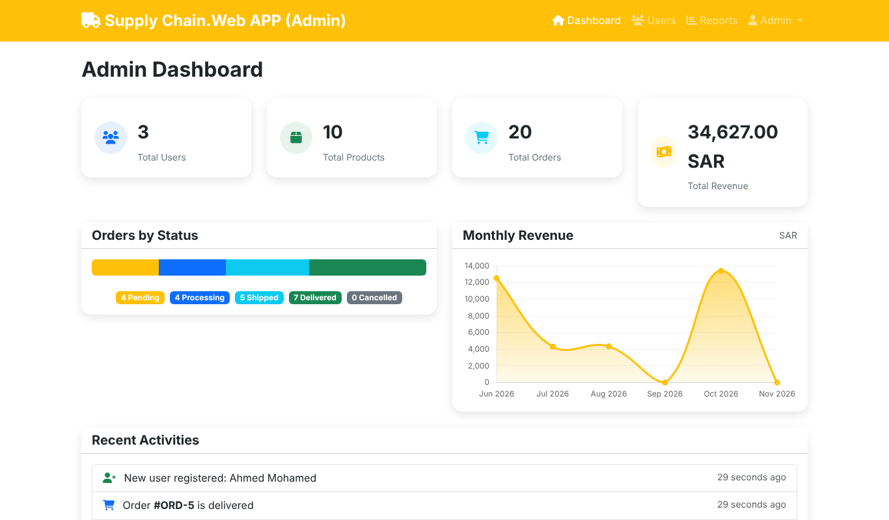
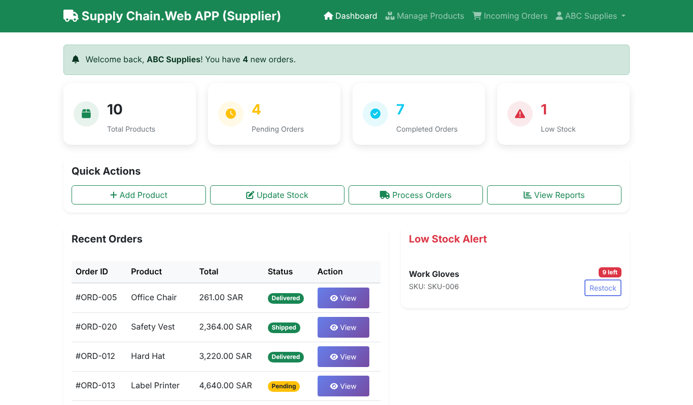
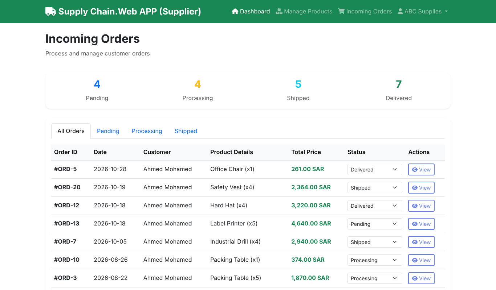
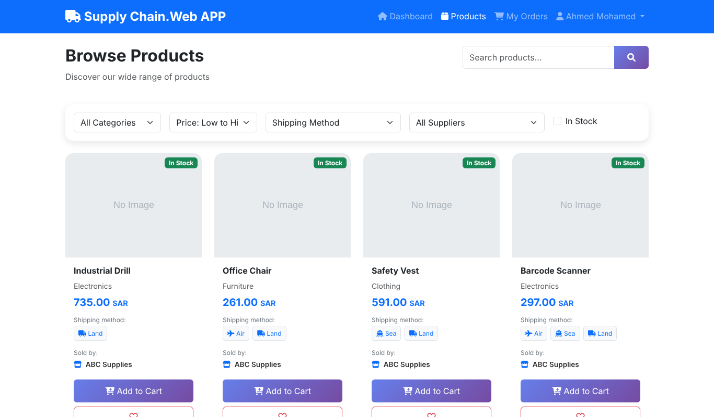
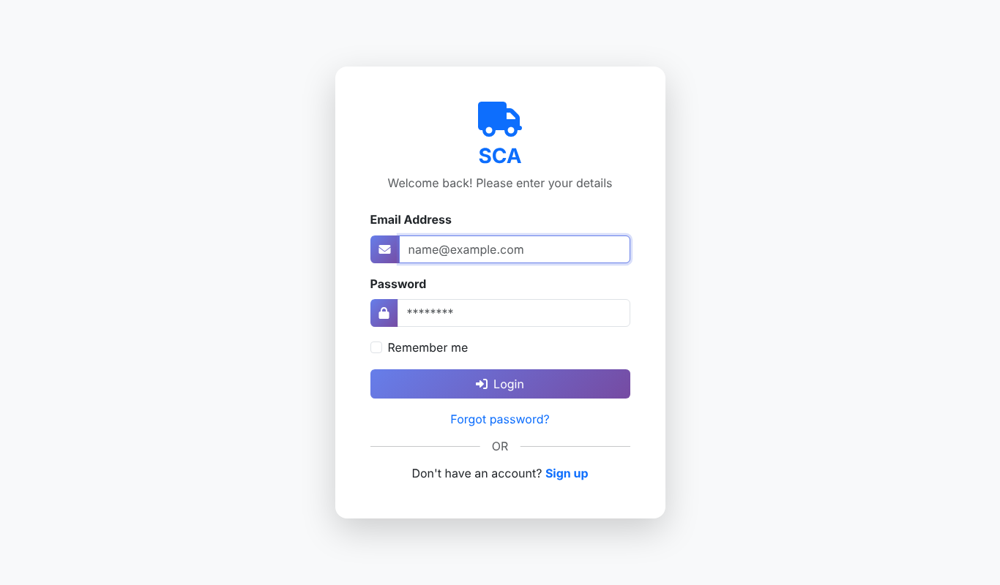
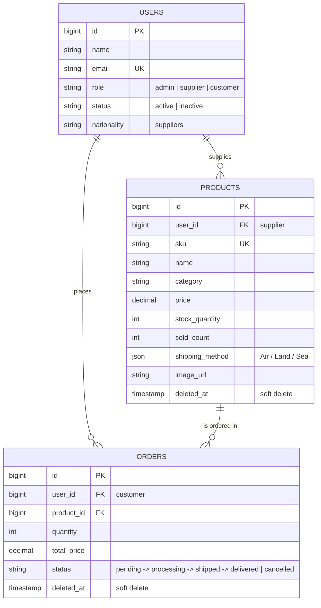

# 📦 Supply Chain Application (SCA)


> **Graduation project (IT Senior Project II)** · Saudi Electronic University, College of Computing & Informatics
> Supervised by **Dr. Hamed Alsharari**

SCA is a web platform that connects **suppliers** and **customers** in one supply chain, with an **admin** overseeing it. Suppliers manage their catalogue and process incoming orders. Customers browse, order and track their purchases. Admins manage users and get revenue and inventory reports. Stock and sales update automatically with every order.



---

## ✨ Features by role

| 🛡️ Admin | 🏭 Supplier | 🛒 Customer |
|---|---|---|
| KPIs: users, products, orders, revenue | Dashboard: pending/completed orders, low-stock alerts | Dashboard with order stats and recommended products |
| Orders-by-status breakdown and a **6-month revenue chart** | Create, edit and delete products with image, SKU, category, price, stock and shipping methods (Air / Land / Sea) | Browse products with **search, category, price sort, shipping-method and supplier filters** |
| User management: create, edit role, activate/deactivate, delete | **Incoming orders**: update status (pending → processing → shipped → delivered) with live counters | Place orders with **stock validation** |
| Reports (top products, low stock) and **CSV export** | Sees only *their own* products and orders | Track and filter their orders, and cancel before shipping (stock is returned) |

## 🖼️ Screenshots

| Supplier dashboard | Incoming orders |
|---|---|
|  |  |
| **Customer product catalogue** | **Login** |
|  |  |

More screenshots are in [`docs/screenshots`](docs/screenshots).

## 🗄️ Data model



## 🏗️ Architecture

- **Laravel 12 MVC**: role-specific controllers (`Admin/`, `Supplier/`, `Customer/`) and Blade views per role
- **Authorization** with Laravel Gates (`isAdmin`, `isSupplier`, `isCustomer`) applied as route middleware, plus **ownership checks** inside every supplier and customer action
- **Authentication** via Laravel Breeze, with login rate limiting, strong password rules, and blocking of deactivated accounts
- **Database transactions with row locking** when placing orders, so two customers can't buy the last units at the same time
- **Soft deletes** on products and orders, so order history stays intact
- **UI**: Bootstrap 5, Font Awesome and Chart.js

## 🔒 Post-submission hardening

After the project was submitted, I reviewed the code and fixed the following. Each fix is covered by an automated test:

| Issue | Risk | Fix |
|---|---|---|
| Users could choose **Admin** when signing up | Privilege escalation | Self-registration is limited to customer/supplier; admins are created by an admin |
| A supplier could edit, delete or change the status of **another supplier's** products and orders (IDOR) | Data tampering | All supplier queries are scoped to the logged-in supplier |
| A customer could view **any** order by ID | Data leak | Orders are scoped to their owner |
| Product update saved raw request input | Mass assignment (e.g. changing `user_id`) | Only validated fields are saved |
| Deactivated accounts could still log in | Access control | Login rejects inactive users |
| Ordering wasn't atomic, and `sold_count` never increased | Overselling, wrong "top products" report | Transaction + `lockForUpdate`, and sales counters updated on order and cancel |
| Missing `shipping_method` migration and missing `dashboard` route | Fresh install / profile page broken | Added the migration and a role-aware `/dashboard` route |
| Revenue chart used hard-coded numbers | Misleading report | Computed from real orders for the last 6 months (cancelled orders excluded) |

## 🚀 Getting started

**Requirements:** PHP 8.2+, Composer, Node 18+ (MySQL via XAMPP is optional; SQLite works out of the box)

```bash
git clone https://github.com/Moleo10/supply-chain-app.git
cd supply-chain-app

composer install
npm install && npm run build

cp .env.example .env
php artisan key:generate

touch database/database.sqlite        # or configure MySQL in .env
php artisan migrate --seed
php artisan storage:link

php artisan serve                     # http://localhost:8000
```

**Demo accounts** (password: `password`):

| Role | Email |
|---|---|
| Admin | `admin@scm.com` |
| Supplier | `supplier@scm.com` |
| Customer | `customer@scm.com` |

## 🧪 Tests

```bash
php artisan test
```

There are **40 tests (129 assertions)**. They cover authentication, role-based access, the ownership checks above, ordering and stock logic, cancellation, admin user management, the CSV export, and a smoke test that renders every page for each role with seeded data. GitHub Actions runs them on every push.

## 👥 Team

Built by a team of six IT students:

- Mohammed Almutairi
- Khalid Alqaimez
- Mohammed Mosaeb
- Faisal Alzahrani
- Abdullah Alharbi
- Samer Alomayri

**Supervisor:** Dr. Hamed Alsharari · Saudi Electronic University
